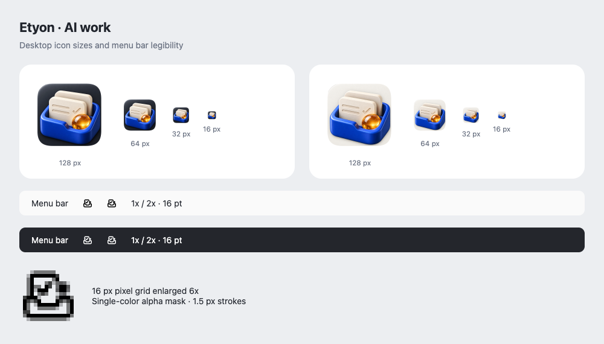

# AI work 图标

桌面图标采用蓝色工作盒、奶白任务卡和琥珀色智能核心，配深浅两种圆角底板。原始设计稿和桌面源稿保存在 `doc/assets/app-icon/`，应用实际读取 `apps/desktop/resources/` 中的导出文件。

| 用途 | 文件 | 尺寸 |
| --- | --- | --- |
| 默认 Dock / 窗口图标 | `icon-dark.png` | 1024 × 1024 |
| 浅色 Dock / 窗口图标 | `icon-light.png` | 1024 × 1024 |
| macOS 打包 | `icon.icns` | 16–1024，多分辨率 |
| Windows 打包 | `icon.ico` | 16、20、24、32、40、48、64、128、256 |
| Linux 打包 | `icon.png` | 512 × 512 |
| macOS 菜单栏 | `tray-template.png` | 16 × 16，16 pt |
| macOS Retina 菜单栏 | `tray-template@2x.png` | 32 × 32，16 pt |

菜单栏图形使用独立 SVG，按小尺寸重新绘制。单色轮廓和实心圆点保持透明背景，系统负责浅色、深色与选中状态的着色。菜单栏不跟随应用图标的深浅选项。

## 重新生成

在 macOS 仓库根目录执行：

```sh
vp exec electron script/generate-app-icons.cjs
```

依赖项目已有的 Electron 和 macOS 自带的 `iconutil`，无需额外图像处理包。脚本使用临时用户目录与隐藏窗口，不读取 Etyon 的会话或设置。桌面源稿在导出时应用固定圆角轮廓，去掉透明留白中的杂点，再转换成各尺寸 PNG / ICNS / ICO；原始源稿保留不变。菜单栏 SVG 在目标像素尺寸直接栅格化，保留 1x / 2x 表示。生成过程会检查 Electron 能否将模板作为 `16 pt` 图像加载并找到 `2x` 资源。

## 预览



预览包含桌面 `128 / 64 / 32 / 16 px`、菜单栏原尺寸，以及 `16 px` 模板的像素放大图。预览里的菜单栏背景用于检查对比度，系统实际着色由 `setTemplateImage(true)` 完成。

## 验证记录（2026-10-15）

- `vp check apps/desktop/src/main/app-metadata.ts apps/desktop/src/main/tray.ts apps/desktop/forge.config.ts script/generate-app-icons.cjs`：4 个文件通过格式和 lint 检查。
- `vp exec tsc --noEmit -p apps/desktop/tsconfig.json`：通过。
- `vp exec electron script/generate-app-icons.cjs`：完成资源导出与完整预览，模板读回为 `16 × 16 pt`，scale factors 为 `[1, 2]`。
- 独立 Electron 验证进程对实际 `createRuntimeIcon()` / `createTrayIcon()` 做运行检查：开发资源目录、模拟打包平铺目录、模拟打包嵌套目录的深浅图标均可读取，模板标识与 Retina 表示正确；实际创建系统 `Tray` 后读回非空布局尺寸，再销毁退出。
- ICO 的 9 个 PNG 帧逐一解码并核对尺寸；ICNS 经系统 `iconutil` 反解后核对 10 个图像帧；菜单栏 PNG 的颜色通道为纯黑，透明度通道有效。

未生成完整安装包，未做 Windows / Linux 实机验收；模拟打包目录检查不等于安装包验收。

## 源稿生成

桌面源稿使用内置 imagegen 编辑。提示内容：保留原始蓝色盒体、两张奶白任务卡、勾选和琥珀玻璃球的构图及材质；添加深石墨色圆角应用底板和透明留白；浅色版只将底板改为暖白瓷质；清理透明边缘杂点，不添加文字或其他符号。菜单栏 SVG 为手工绘制的简化图形。
